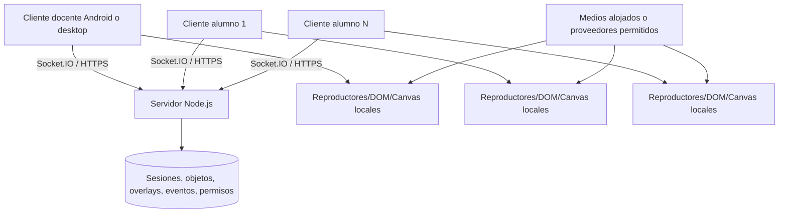

# 02 — Arquitectura candidata y alternativas
**Propuesta técnica (NO implementación aprobada):**
- Cliente web/PWA: TypeScript o JavaScript, UI responsive, motor de lienzo HTML Canvas/SVG con capas y objetos vectoriales. Renderizar PDF/video/web como componentes DOM sobre coordenadas del mundo, no intentar decodificarlos como trazos Canvas.
- Servidor: **Node.js + Socket.IO** para salas, eventos y control de acceso en tiempo real; HTTP API para autenticación, documentos y recuperación de estados.
- Persistencia piloto: SQLite para sesiones, objetos, secciones, overlays, eventos y permisos. Ficheros de contenido en almacenamiento privado local (luego S3/R2 o equivalente si se necesita). No depender de Supabase Realtime ni enviar cada muestra del lápiz a servicios externos.
- Medios: reproducción **en cada cliente** desde fuente autorizada; sincronizar comandos/reloj, NO retransmitir píxeles/audio del reproductor docente.
- Videollamada (opcional en otra fase): WebRTC P2P para 1:1 y TURN si redes no permiten conexión directa; para varios participantes se requiere evaluación de SFU y sus costes. Videollamada **no** es lo mismo que audio/video educativo sincronizado.

## Flujo lógico

## Capas de estado
1. **Servidor autoritativo:** identidades, roles, miembros, permisos, mapa de objetos publicados, órdenes multimedia, cursores de secciones, versiones individuales.
2. **Estado de presentación público:** lienzo/viewport compartido, recursos insertados y sección elegida, según visibilidad.
3. **Estado privado docente:** búsquedas, borradores, notas privadas, monitor/foco, zoom docente, vista previa y herramientas de gestión.
4. **Estado de alumno:** versión individual del ejercicio, punto de reproducción individual, zoom/cámara propia autorizada.
5. **Estado efímero:** cursores, punteros en vivo, previsualización de trazos, indicadores de actividad; no necesariamente persistir cada muestra.

## Elección de motor de dibujo
- Candidato histórico: `cracker0dks/whiteboard` (Node.js, licencia MIT conocida): revisar código, actividad reciente, dependencias, licencia exacta y compatibilidad táctil **antes** de reutilizar.
- Alternativas: `lovasoa/whitebophir` (WBO, AGPL-3.0 con obligaciones de distribución/acceso por red), o implementación propia con Canvas/SVG y protocolo propio.
- **No elegir automáticamente** un repositorio sólo por sus capturas. Hacer una POC con S Pen, overlay DOM, rendimiento y licencias.
- No reutilizar BigBlueButton: complejidad excesiva para requisitos presentes. OpenBoard/Open-Sankoré sirven como referencia histórica del usuario, **no** como interfaz de pestañas.

## Límites y realismo de hosting
- Licencias gratuitas no significan infraestructura gratuita en cualquier escala. PWA + servidor Node en PC propia puede permitir prototipo barato, pero requiere equipo encendido, red confiable, HTTPS y mecanismo para exposición segura.
- Cloudflare Tunnel puede ayudar a exponer un servidor de pruebas sin abrir puertos; validar condiciones, políticas, dominios y límites actuales antes de producción.
- Audio/video propio implica ancho de banda de los **proveedores de medios** y derechos de uso. Si se alojan medios propios, medir egreso por usuarios.
- Un navegador no permite embeber cualquier sitio: CSP/X-Frame-Options/DRM/CORS/autoplay afectan la experiencia.
- Definir backups y recuperación; SQLite no equivale a estrategia de respaldo.

## Integración con COG
Expediente nuevo bajo Engineering. **No editar** juegos, rutas, Teacher Monitor ni configuración de despliegue actual para esta fase. Cuando se implemente, separar proyecto/ruta, revisar CI, despliegue, licencias y seguridad antes de tocar `main`.
